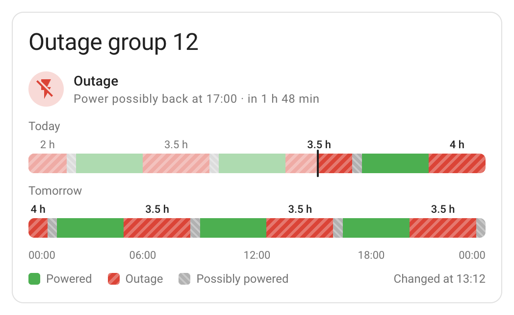

# Chernivtsi Power Outages for Home Assistant

[](https://github.com/maxbanton/hass-chernivtsi-outages/actions/workflows/tests.yml)
[](https://github.com/maxbanton/hass-chernivtsi-outages/actions/workflows/validate.yml)
[](LICENSE)
[](https://www.home-assistant.io)

Scheduled power outages for the Chernivtsi region (Bukovyna, Ukraine) in Home
Assistant: the current state of your outage group, the next outage, when power
comes back, a calendar, events when the schedule changes, and a dashboard card.

[Українською](README.md)



> **Unofficial.** This project is not affiliated with or endorsed by
> JSC Chernivtsioblenergo. It reads the schedule they publish on
> [oblenergo.cv.ua](https://oblenergo.cv.ua/shutdowns/) and their
> [Telegram channel](https://t.me/oe_cv_ua). Emergency outages can also happen
> outside the schedule.
> Use it at your own risk. See the [disclaimer](#disclaimer).

## What it's for

The schedule changes several times a day, outages get moved earlier or later,
and tomorrow's schedule often appears late in the evening. With the schedule in
Home Assistant you can:

- charge a home battery from the grid before an outage starts, and adjust the
  charging plan whenever the schedule changes;
- check that the battery holds enough energy for the next outage and, if not,
  turn off non-essential loads early;
- run the water heater, washing machine or heating during the hours when power is
  scheduled to be on;
- get a notification before an outage and when the schedule changes.

## The three states

Each half-hour slot in the schedule has one of these states:

| State | On the site | Meaning |
|---|---|---|
| `on` | green, ‘з’ | powered |
| `off` | red, ‘в’ | outage |
| `maybe` | grey, ‘мз’ | possibly powered |

The integration keeps the three apart everywhere: ‘мз’ never counts as powered
or as an outage.

## Entities

Each group gets a device with these entities:

| Entity | Example | Description |
|---|---|---|
| Schedule now | `sensor.outage_group_12_schedule_now` | `on`, `off` or `maybe` right now, as scheduled. The `today` and `tomorrow` attributes hold each day's periods. |
| Scheduled power | `binary_sensor.outage_group_12_scheduled_power` | On while power is scheduled to be on. Off during outages and possibly powered hours. |
| Expected next outage | `sensor.outage_group_12_expected_next_outage` | Start of the next scheduled outage that has not begun yet. Also has the `end` and `duration_hours` attributes. |
| Power expected back | `sensor.outage_group_12_power_expected_back` | Scheduled end of the current outage, or of the next one. The `then` attribute says whether `on` or `maybe` follows. |
| Scheduled outage hours today | `sensor.outage_group_12_scheduled_outage_hours_today` | Scheduled outage hours today. |
| Possibly powered hours today | `sensor.outage_group_12_possibly_powered_hours_today` | Possibly powered hours today. Disabled by default. |
| Last schedule change | `sensor.outage_group_12_last_schedule_change` | When the current version of today's schedule was published (diagnostic). |
| Scheduled outages | `calendar.outage_group_12_scheduled_outages` | Calendar: outages and possibly powered hours, today and tomorrow. |
| Schedule change | `event.outage_group_12_schedule_change` | Receives an event when the schedule changes (see below). |

The example IDs assume Home Assistant is set to English.

All of these describe the published schedule, not the actual state of the grid:
emergency outages happen, and power is sometimes cut or restored late. For the
real state, use your own grid power sensor.

States change at :00 and :30. Anything that depends on a schedule not yet
published is `unknown`, such as the end of an outage that runs past midnight.

The outage hours sensors count each half hour as it was scheduled at that
moment, so later revisions do not rewrite the past. They also have the
`revisions_today` and `originally_scheduled_hours` attributes.

### Schedule change events

The event entity receives one of these event types, with a `date` and a `changes`
list (`type`, `start`, `end`, `old_start`, `old_end`):

| Event type | When |
|---|---|
| `schedule_published` | a schedule for a new day was published |
| `outage_earlier` | an outage now starts earlier |
| `outage_added` | a new outage was added |
| `outage_longer` | an outage now ends later |
| `outage_later` | an outage now starts later |
| `outage_shorter` | an outage now ends earlier |
| `outage_removed` | an outage was cancelled |
| `schedule_changed` | something else changed, such as possibly powered hours |

When several things change at once, the event gets the most urgent type and the
`changes` list includes all of them. The entity receives no event when Home
Assistant starts, so automations that plan around outages should also run at
startup.

## Where the data comes from

The schedule comes from the outage schedule page on oblenergo.cv.ua. Posts in the
oblenergo Telegram channel tell the integration when a new schedule is out, so
changes show up within minutes.

If the site is down, the integration uses the hours posted in the channel. The
channel lists only the hours with power, so the rest of the day is shown as an
outage and the Schedule now sensor gets the attribute `degraded: true`.

## Installation

### HACS

1. In HACS, open the menu, select **Custom repositories** and add
   `https://github.com/maxbanton/hass-chernivtsi-outages` as an **Integration**.
2. Open **Chernivtsi Power Outages**, select **Download** and restart Home
   Assistant.

### Manual

Copy `custom_components/chernivtsi_outages` into your `config/custom_components`
folder and restart Home Assistant.

## Configuration

Go to **Settings** > **Devices & services** > **Add integration** >
**Chernivtsi Power Outages** and pick one or more groups. Find your group by
address on the [oblenergo search page](https://oblenergo.cv.ua/shutdowns-search/).
To change the groups later, select **Configure** on the integration's page.

## Card

The integration comes with a dashboard card, so there is nothing else to
install. When editing a dashboard, add it like any other card (search for
**Chernivtsi Power Outages**) or in YAML:

```yaml
type: custom:chernivtsi-outages-card
entity: sensor.outage_group_12_schedule_now
```

It shows the current state with a countdown to the next change, plus timelines
for today and tomorrow. Set `title` to change the header text; `title: ""`
hides the header.

## Automation examples

Notify 30 minutes before an outage:

```yaml
automation:
  - alias: Outage in 30 minutes
    triggers:
      - trigger: time
        at:
          entity_id: sensor.outage_group_12_expected_next_outage
          offset: "-00:30:00"
    actions:
      - action: notify.notify
        data:
          message: >-
            Outage at {{ as_timestamp(states('sensor.outage_group_12_expected_next_outage'))
            | timestamp_custom('%H:%M') }}
```

React to schedule changes:

```yaml
automation:
  - alias: Outage earlier or added
    triggers:
      - trigger: state
        entity_id: event.outage_group_12_schedule_change
    conditions:
      - condition: template
        value_template: "{{ trigger.to_state.attributes.event_type in ['outage_earlier', 'outage_added'] }}"
    actions:
      - action: notify.notify
        data:
          message: "Outage schedule changed: {{ trigger.to_state.attributes.event_type }}"
```

## Troubleshooting

- In the integration's three-dot menu, select **Download diagnostics** and
  attach the file to your issue.
- If the layout of the oblenergo site or the Telegram channel page changes,
  Home Assistant reports it under **Settings** > **System** > **Repairs**.
  Please open an issue in this repository.

## Removal

Delete the integration under **Settings** > **Devices & services**. The card's
resource and the stored schedule are removed with it. Then remove it
from HACS, or delete the files if you installed it manually.

## Disclaimer

This software is provided ‘as is’, without warranty of any kind, express or
implied. See [LICENSE](LICENSE).

- It is not affiliated with, endorsed by or supported by JSC
  Chernivtsioblenergo.
- The schedule it shows may be late, incomplete or wrong: the oblenergo site or
  the Telegram channel can change or be unavailable, and the schedule can change
  after the integration has read it. Only the schedule Chernivtsioblenergo
  publishes is authoritative, and outages can happen outside it.
- Do not rely on it for safety-critical decisions. A line the schedule shows as
  off can be energised at any time. Never use it to decide whether electrical
  work is safe.
- Automations built on it (switching loads, generators, chargers or other
  equipment) are your responsibility. Check what they do when the schedule is
  wrong or missing.
- You use it entirely at your own risk. The author and contributors are not
  liable for any damage to equipment or property, personal injury, data loss,
  financial loss or any other direct or indirect consequence of installing or
  using it.

## License

MIT
